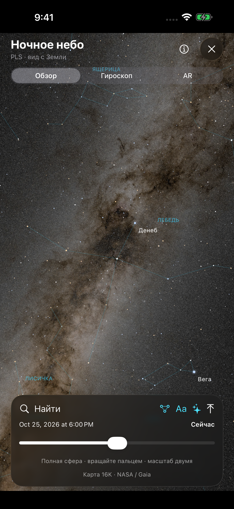
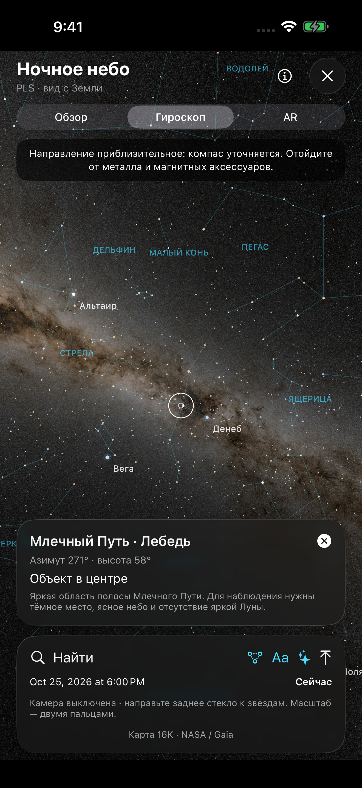
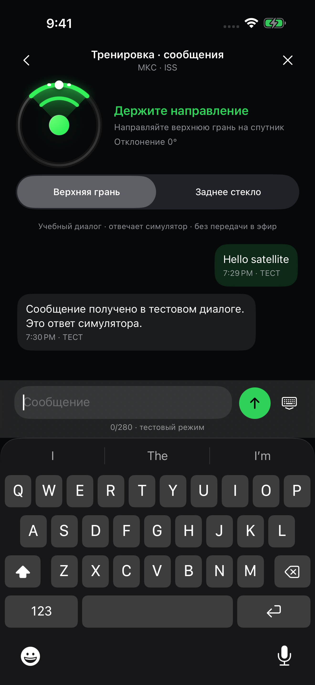
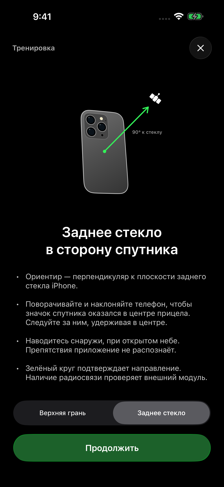
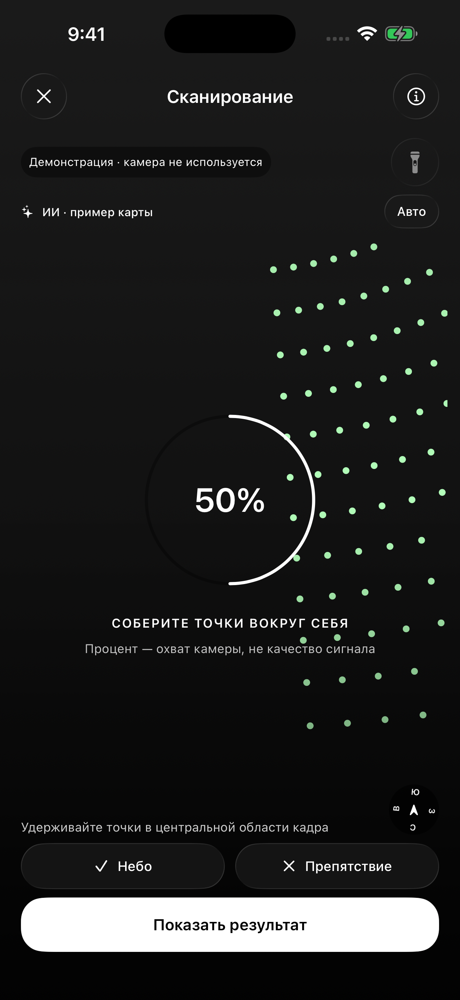
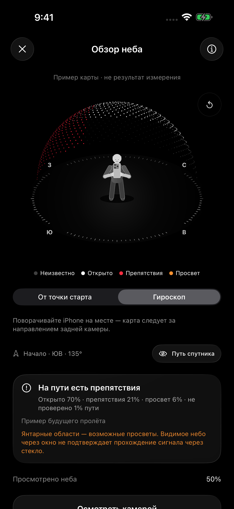

# Ploit Link Satellite (PLS)

  
  
  

*Главный экран · наведение · орбиты. Наведение на снимке показано в режиме тренировки.*

**Ploit Link Satellite (PLS)** — концепт приложения для iPhone, которое помогает общаться через спутниковые ретрансляторы с помощью внешнего радиомодуля. Цель проекта — обмен сообщениями за пределами мобильного покрытия.

Приложение помогает выбрать спутник, найти ближайший сеанс, направить антенну и проверить окружающее небо на препятствия. В тренировочном диалоге индикатор наведения остаётся видимым во время набора текста. Передача в эфир предусмотрена через отдельный модуль со своей антенной и питанием. Сейчас диалог работает с локальным симулятором; подключение реального оборудования находится в разработке.

**iPhone → внешний радиомодуль → спутниковый ретранслятор → радиомодуль получателя → его телефон**

Это планируемая схема связи. Сейчас в приложении работают каталог спутников, радиопрофили, прогноз пролётов, интерактивный глобус и наведение по датчикам iPhone. Обмен сообщениями, управление внешним модулем и подтверждения доставки ещё не реализованы.

## Возможности

- **Спутники и сеансы.** Каталог с частотами, режимами, источниками данных и ближайшими окнами видимости для выбранной позиции.
- **Автовыбор.** Главный экран рекомендует ближайшее окно среди спутников с режимом ретрансляции и сообщает, если пролёт ожидается в течение часа. Автовыбор переключает спутник между сеансами и приостанавливается во время наведения, просмотра орбит и проверки места.
- **Два направления антенны.** Наведение верхней гранью iPhone или нормалью к заднему стеклу. Для заднего стекла цель нужно удерживать в центре прицела.
- **Два вида наведения.** Круговой индикатор и вид с Землёй, подсказками поворота и текущими данными о пролёте.
- **Интерактивные орбиты.** Пространственные орбиты вокруг Земли, вращение вокруг полярной оси, наклон вверх и вниз, масштабирование, выбор одного спутника или всего каталога.
- **Перемотка времени.** Диапазон от 6 часов назад до 48 часов вперёд, переход к началу сеанса, воспроизведение ×1, ×60 и ×300.
- **Ночное небо.** Каталог 5 070 звёзд и созвездий поверх карты 16 384 × 8 192 (NASA/Goddard SVS; Gaia DR2: ESA/Gaia/DPAC). Карта рисуется в разрешении экрана; сжатые текстуры загружаются прямо в графическую память без распаковки полноразмерного изображения. Свободный обзор позволяет вращать всю небесную сферу, смотреть под горизонт, искать объект прицелом и менять время в пределах ±12 часов. Подземная часть затемнена и помечена. Режим «Гироскоп» позволяет наводиться задним стеклом iPhone без камеры: карта следует за поворотами телефона, прицел показывает выбранный объект. AR показывает также 18° ниже горизонта, сохраняя истинные направления объектов. Направление зависит от компаса; текущую видимость, облака и засветку карта не измеряет. Данные встроены и работают без интернета.
- **Сообщения при наведении.** В тренировке кнопка «Тестовые сообщения» открывает клавиатуру под живым индикатором спутника. Доступны верхняя грань и заднее стекло. При отклонении отправка приостанавливается, набранный текст сохраняется. Диалог локальный: отвечает симулятор, передачи в эфир нет.
- **День и ночь.** Освещение Земли следует за выбранным временем; огни городов видны на ночной стороне. Карты поверхности имеют разрешение 8K.
- **Режим тренировки.** Знакомство с наведением без ожидания настоящего пролёта.
- **Сканирование неба.** Сетка из 3600 направлений с шагом 3°. Собранные зелёные точки сходятся к центру и исчезают с мягким тактильным откликом. Во время сканирования доступен фонарик. Охват камеры учитывается отдельно от результата распознавания.
- **Анализ камерой и LiDAR.** Нейросеть на iPhone распознаёт небо, здания, деревья, стены и окна. Несколько последовательных кадров объединяются с измерениями близких поверхностей LiDAR, если он доступен. Есть режимы «Авто», «На улице» и «В помещении»; результат можно уточнить вручную.
- **Карта препятствий.** Разреженная точечная полусфера с компасом. Человек держит iPhone 16 Pro Max двумя руками и смотрит в сторону начала сканирования; исходный ракурс — из-за его спины. Можно осматривать карту пальцем или поворотом iPhone в режиме гироскопа. Путь ближайшего пролёта включается отдельно. Белые точки — видимое открытое небо, красные — препятствия, янтарные — возможные просветы, тёмные — непроверенные направления.
- **Осмотр места.** Сохранённые отметки можно увидеть поверх камеры, поворачивая телефон на той же точке. Этот режим не изменяет собранную карту.
- **Обновление при открытии.** TLE и местная погода из Open-Meteo обновляются автоматически при наличии интернета и координат. Свежие результаты используются из кэша; повторные запросы ограничены. Погоду также можно обновить вручную. Указаны источник и время данных; наблюдения старше часа помечаются как устаревшие.
- **Работа без интернета.** После загрузки орбитальных данных расчёт положения, пролётов и направления выполняется на устройстве.

Экран «Орбиты» запрашивает 120 Гц на совместимых дисплеях и 60 Гц на остальных. Частоту определяет iOS с учётом настроек, нагрузки, температуры и энергосбережения. На iOS 26 интерфейс использует Liquid Glass, на более ранних поддерживаемых системах — совместимые материалы.

Дневная и ночная стороны Земли

  
  

Примеры дневной и ночной сторон. Используются статические карты NASA; они не показывают текущую облачность.

## Как пользоваться

**Наведение на звёзды без камеры:** откройте «Ночное небо» → «Гироскоп», выберите объект через «Найти» и направьте заднее стекло iPhone по метке. Для осмотра карты пальцем выберите «Обзор», для наложения на камеру — «AR».

Ночное небо и сообщения при наведении

  
  
  

Карта неба: NASA/Goddard SVS; Gaia DR2: ESA/Gaia/DPAC. Снимки интерфейса из симулятора; сообщения учебные.

1. Разрешите доступ к геопозиции и движению или задайте координаты вручную в настройках.
2. Выберите спутник и подходящий радиопрофиль. Посмотрите ближайший сеанс во вкладке «Пролёты».
3. Откройте «Орбиты», чтобы увидеть положение спутника сейчас или заранее посмотреть будущий пролёт.
4. Выберите ось наведения под конструкцию своей антенны: верхняя грань или заднее стекло.
5. Начните наведение снаружи, при открытом обзоре неба. Следуйте подсказкам и удерживайте направление за движущимся спутником.

Как направлять заднее стекло

  

Для антенны на задней стороне телефона ориентиром служит перпендикуляр к стеклу. Значок спутника нужно удерживать в центре прицела.

Крестик в «Орбитах» возвращает на главный экран, в том числе после открытия из каталога или прогноза пролёта.

Зелёный индикатор означает совпадение направления при выполнении условий наведения. Он не подтверждает приём сигнала или установленную радиосвязь. Карта препятствий создаётся отдельно в разделе «Проверить место»; экран наведения не считает её подтверждением связи.

### Проверка места перед сеансом

Экран проверки места

  
  
  

*Демонстрационные снимки симулятора. Камера не используется, отметки не являются результатом измерения.*

Откройте «Проверить место», выберите обстановку и начните сканирование из точки установки антенны. Медленно обведите небо задней камерой, оставаясь на месте. Удерживайте точки в центральной области кадра: собранные точки сходятся к центру, уменьшаются и исчезают с мягким тактильным откликом. Повторный проход по собранным направлениям не вызывает вибрацию. Кнопка фонарика помогает осматривать близкие предметы в темноте; она не освещает дальние здания или деревья. Процент учитывает площадь участков неба; он не показывает качество радиосигнала и не подтверждает отсутствие препятствий.

После включения фонарика сканер использует прямой захват камеры и, при поддержке устройства, синхронную глубину LiDAR. Направление задают датчики движения и компас. В этом режиме небольшие перемещения точки не отслеживаются AR, даже после выключения света: оставайтесь на месте до завершения сканирования. После перемещения начните новую карту.

ИИ анализирует кадры во время сбора точек. Кнопками «Небо» и «Препятствие» можно уточнить область в центре кадра. На итоговой карте белыми точками показано видимое открытое небо, красными — препятствия, янтарными — возможные просветы, тёмными — непроверенные участки. В режиме «От точки старта» карта начинается с направления, в котором началось сканирование. Вращайте её пальцем и меняйте наклон движением вверх и вниз; кнопка сброса возвращает исходный ракурс. В режиме «Гироскоп» задняя камера задаёт направление обзора сохранённой карты. Переключатель «Путь спутника» показывает жёлтую линию прогноза пролёта с пояснением.

Нажмите «Осмотреть камерой», чтобы видеть сохранённые отметки в соответствующих направлениях при повороте телефона. Оставайтесь в исходной точке. После перемещения карта требует повторного сканирования.

На улице анализ ищет открытое небо над зданиями и деревьями. В помещении видимое через окно небо отмечается как возможный просвет: стекло, покрытия и рамы могут препятствовать радиосвязи. Режим «Авто» уточняет обстановку по нескольким кадрам; ошибочный выбор можно исправить вручную. Измеренная LiDAR близкая поверхность до 6 метров имеет приоритет над распознаванием неба. Отсутствие глубины не считается открытым небом. Без LiDAR работает анализ камеры; при недоступной модели остаётся ручная разметка.

Сканирование оценивает видимые препятствия, но не измеряет прохождение радиосигнала через материалы. Модель может ошибаться на отражениях, прозрачных поверхностях, в темноте и на незнакомых объектах. Результат не подтверждает работу ретранслятора или связь с модулем. После перемещения нужна новая карта.

В блоке «Местные условия» показана сохранённая погода по модели Open-Meteo с временем обновления. При открытии приложения данные обновляются автоматически; в блоке доступно ручное обновление. Это оценка условий в районе наблюдения, а не измерение на антенне и не прогноз именно на будущий сеанс. Облачность сама по себе не определяет доступность связи на 145/435 МГц; состояние антенны, деревья и крыша учитываются отдельно. Без интернета условия можно отметить вручную.

## Установка

Сборки для iPhone доступны в разделе **[Releases — скачать IPA](https://github.com/Iversat/Ploit-Link-Satellite/releases/latest)**. В файлах выпуска находятся IPA и его контрольная сумма SHA256.

IPA распространяется без подписи. Перед установкой подпишите его своим способом. Для работы требуется iOS 17 или новее.

## Сборка без собственного Mac

Приложение собирается через GitHub Actions: macOS и Xcode запускаются на сервере GitHub.

В своей копии репозитория откройте **Actions → Build unsigned IPA → Run workflow**. После успешного запуска скачайте артефакт `Ploit-Satellite-unsigned-IPA`. Отдельный workflow **Earth visual QA and unsigned IPA** проверяет цвета Земли на кадрах приложения и собирает IPA.

Для локальной сборки на Mac нужны Xcode и XcodeGen. Структура проекта описана в `project.yml`; Xcode-проект создаётся командой `xcodegen generate`.

## Орбитальные данные и радиосвязь

Расчёты выполняются по модели SGP4 с помощью библиотеки satellite.js и TLE из CelesTrak; при недоступности источника используется SatNOGS DB. Интернет нужен для обновления TLE; сохранённые данные доступны офлайн. Для автоматической рекомендации нужны данные не старше 3 суток. Если для выбранного времени данные старше 14 суток, наведение отключается.

Окно видимости рассчитывается для позиции наблюдателя и выбранной маски горизонта. Оно не подтверждает, что ретранслятор включён. Частоты, доступные режимы, источники и даты проверки указаны в карточках спутников.

Цель проекта — связь через внешний модуль. Приложение не открывает доступ к спутниковому модему iPhone и не является работающим сервисом экстренной связи. PLS — независимый проект, не связанный с Apple, SpaceX или Starlink.

## Данные на устройстве

Расчёт орбит и показания датчиков обрабатываются локально. Для обновления орбит приложение запрашивает данные по номеру спутника; координаты наблюдателя в этот запрос не включаются. Рядом с магнитами, металлом и работающим передатчиком компас может ошибаться.

Камера запрашивается только при начале сканирования. Кадры и глубина обрабатываются на iPhone, не записываются и не передаются. Карта обзора хранится до закрытия экрана; ручные погодные наблюдения также остаются на устройстве.

Модель распознавания включена в приложение и работает без интернета. Она загружается в фоне при запуске приложения и повторно используется между сканированиями. После полного завершения приложения iOS требуется снова загрузить модель в память; скачивания при этом нет. Анализ выполняется последовательно в фоновом потоке с ограничением частоты; кадры сопоставляются с направлением камеры и глубиной в момент съёмки. Потеря привязки камеры, остановка или новая проверка отменяют применение устаревшего результата.

Точки появляются после определения положения камеры, независимо от готовности ИИ и компаса. В помещении можно осматривать стены, окна и потолок без требования найти небо. Сетка относится к направлениям над горизонтом, откуда возможен пролёт спутника. Пока компас уточняет север, доступен анализ изображения, но направления не записываются в карту пролёта: неподтверждённая ориентация не должна создавать ложный прогноз.

При открытии и во время работы приложения, а также при ручном обновлении погоды координаты, округлённые до 0,01°, передаются в Open-Meteo через HTTPS. Автоматический запрос повторяется после истечения 15 минут свежести кэша или смены места с учётом ограничения частоты запросов. Сервис также получает IP-адрес. Свежие данные сохраняются на устройстве и доступны без интернета. Обновление выполняется только пока приложение активно, без постоянной фоновой загрузки. [Условия и политика конфиденциальности Open-Meteo](https://open-meteo.com/en/terms) описывают обработку данных сервисом. Бесплатный API используется для некоммерческого проекта.

## Название и использование кода

Название **Ploit Link Satellite** сохраняется за проектом. В компактном интерфейсе допустимо **PLS** при наличии полного названия в разделе «О приложении». При распространении производных сборок нужно сохранять название, происхождение проекта и уведомления об авторстве. Свои изменения можно подписывать своим именем, а сборку нужно обозначать как неофициальную.

Условия изложены в [LICENSE](LICENSE) и [политике названия и авторства](BRANDING.md). Исходный код доступен по собственной лицензии с ограничениями на переименование. Материалы, ранее опубликованные под MIT, сохраняют первоначальные разрешения; их текст находится в [LICENSES/Ploit-Space-MIT-legacy.txt](LICENSES/Ploit-Space-MIT-legacy.txt). Лицензии сторонних компонентов сохраняются.

## Материалы и источники

В проекте используются:

- [NASA Black Marble](https://science.nasa.gov/earth/earth-observatory/earth-at-night/maps/) — ночная карта и огни городов.
- [NASA Blue Marble Next Generation](https://science.nasa.gov/earth/earth-observatory/blue-marble-next-generation/base-topography-bathymetry/) — дневная карта поверхности; NASA / Reto Stöckli, Robert Simmon.
- [satellite.js](https://github.com/shashwatak/satellite-js) — расчёт SGP4, лицензия MIT.
- [CelesTrak](https://celestrak.org/NORAD/documentation/gp-data-formats.php) — орбитальные данные.
- [SatNOGS DB](https://db.satnogs.org/api/) — резервный источник TLE.
- [Apple ARKit](https://developer.apple.com/documentation/arkit/ardepthdata) — данные камеры и глубины на поддерживаемых iPhone.
- [MMSegmentation MobileNetV2 / DeepLabV3](https://github.com/open-mmlab/mmsegmentation/blob/v0.30.0/configs/mobilenet_v2/README.md) — модель распознавания сцен ADE20K, преобразованная в Core ML. [Источник весов, лицензия и способ воспроизведения](LICENSES/SkyScene-NOTICE.md).
- [Open-Meteo](https://open-meteo.com/) — текущая погода по моделям, данные под [CC BY 4.0](https://creativecommons.org/licenses/by/4.0/). Значения округляются для отображения; источник и лицензия доступны рядом с погодой.
- [Vallado et al.](https://celestrak.org/publications/AIAA/2006-6753/) — эталонные данные для проверки расчётов SGP4.

Полные карты NASA уменьшены из исходников до 8192×4096. Исходные снимки статические; освещение для выбранного времени рассчитывается отдельно. Использование этих материалов не означает поддержку проекта со стороны NASA.

Данные звёзд HYG v4.1 (David Nash / Astronexus, CC BY-SA 4.0), линии созвездий d3-celestial (Olaf Frohn, BSD-3-Clause) сохраняют свои лицензии. Источники и изменения данных описаны в [NightSky-NOTICE](LICENSES/NightSky-NOTICE.md).
