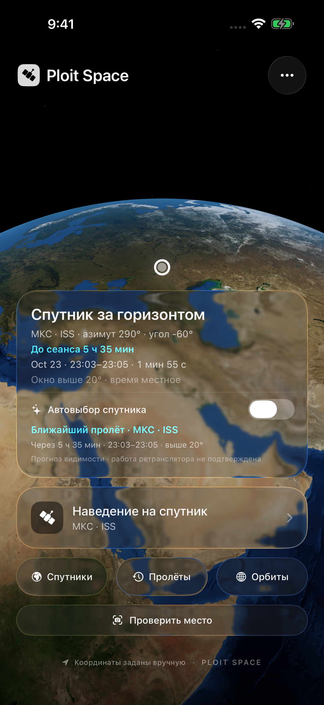
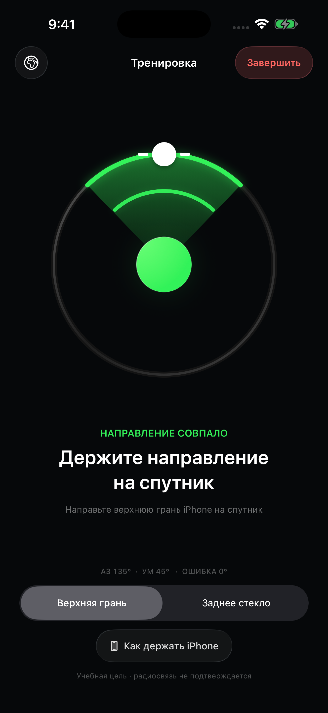
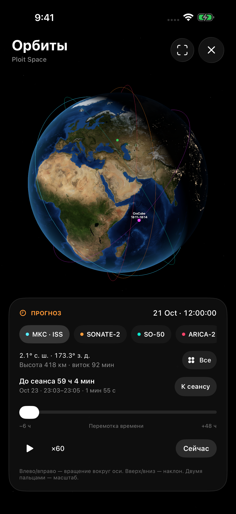
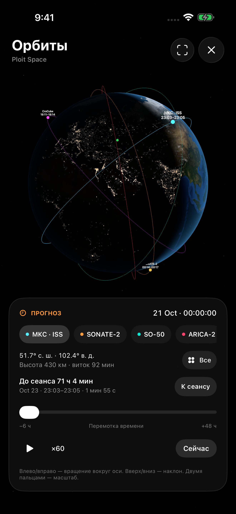
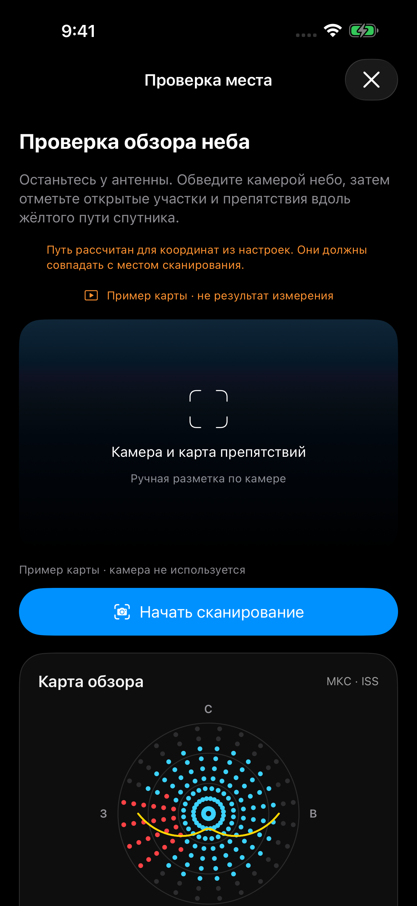

# Ploit Space

  
  
  

*Главный экран · наведение · орбиты. Наведение на снимке показано в режиме тренировки.*

**Ploit Space** — концепт связи телефона через спутниковые ретрансляторы с помощью внешнего радиомодуля. Идея проекта — дать возможность передавать сообщения там, где нет мобильного интернета: выбрать подходящий спутник, дождаться пролёта и навести устройство на него.

Телефон отвечает за интерфейс, расчёт орбит и наведение. Для передачи и приёма планируется использовать отдельный радиомодуль со своей антенной и питанием.

**iPhone → внешний радиомодуль → спутниковый ретранслятор → радиомодуль получателя → его телефон**

Это планируемая схема связи. Сейчас в приложении работают каталог спутников, радиопрофили, прогноз пролётов, интерактивный глобус и наведение по датчикам iPhone. Обмен сообщениями, управление внешним модулем и подтверждения доставки ещё не реализованы.

## Возможности

- **Спутники и сеансы.** Каталог с частотами, режимами, источниками данных и ближайшими окнами видимости для выбранной позиции.
- **Автовыбор.** Главный экран рекомендует ближайшее окно среди спутников с режимом ретрансляции и сообщает, если пролёт ожидается в течение часа. Автовыбор переключает спутник между сеансами и приостанавливается во время наведения, просмотра орбит и проверки места.
- **Два направления антенны.** Наведение верхней гранью iPhone или нормалью к заднему стеклу. Для заднего стекла цель нужно удерживать в центре прицела.
- **Два вида наведения.** Круговой индикатор и вид с Землёй, подсказками поворота и текущими данными о пролёте.
- **Интерактивные орбиты.** Пространственные орбиты вокруг Земли, вращение вокруг полярной оси, наклон вверх и вниз, масштабирование, выбор одного спутника или всего каталога.
- **Перемотка времени.** Диапазон от 6 часов назад до 48 часов вперёд, переход к началу сеанса, воспроизведение ×1, ×60 и ×300.
- **День и ночь.** Освещение Земли следует за выбранным временем; огни городов видны на ночной стороне. Карты поверхности имеют разрешение 8K.
- **Режим тренировки.** Знакомство с наведением без ожидания настоящего пролёта.
- **Проверка места.** Камера и LiDAR на поддерживаемых iPhone помогают составить карту близких препятствий. Открытое небо и дальние препятствия отмечаются вручную. На карте показан путь ближайшего пролёта; непроверенные участки сохраняют статус «неизвестно».
- **Местные условия.** Погоду можно записать вручную или загрузить по кнопке из Open-Meteo: температуру, облачность, осадки и ветер. Указаны источник и время данных; наблюдения старше часа помечаются как устаревшие.
- **Работа без интернета.** После загрузки орбитальных данных расчёт положения, пролётов и направления выполняется на устройстве.

На совместимых дисплеях приложение запрашивает 120 Гц, на остальных — 60 Гц. Частоту определяет iOS с учётом настроек, нагрузки, температуры и энергосбережения. На iOS 26 интерфейс использует Liquid Glass, на более ранних поддерживаемых системах — совместимые материалы.

Дневная и ночная стороны Земли

  
  

Один ракурс в разное время. Используются статические карты NASA; они не показывают текущую облачность.

## Как пользоваться

1. Разрешите доступ к геопозиции и движению или задайте координаты вручную в настройках.
2. Выберите спутник и подходящий радиопрофиль. Посмотрите ближайший сеанс во вкладке «Пролёты».
3. Откройте «Орбиты», чтобы увидеть положение спутника сейчас или заранее посмотреть будущий пролёт.
4. Выберите ось наведения под конструкцию своей антенны: верхняя грань или заднее стекло.
5. Начните наведение снаружи, при открытом обзоре неба. Следуйте подсказкам и удерживайте направление за движущимся спутником.

Крестик в «Орбитах» возвращает на главный экран, в том числе после открытия из каталога или прогноза пролёта.

Зелёный индикатор означает совпадение направления при выполнении условий наведения. Он не подтверждает приём сигнала или установленную радиосвязь. Карта препятствий создаётся отдельно в разделе «Проверить место»; экран наведения не считает её подтверждением связи.

### Проверка места перед сеансом

Экран проверки места

*На снимке показан пример карты в симуляторе, без измерений камерой.*

Откройте «Проверить место» на главном экране и начните сканирование из точки установки антенны. Медленно обведите небо камерой, оставаясь на месте. Голубым отмечаются участки, которые подтверждены вручную как открытые; красным — препятствия, серым — неизвестные участки. Жёлтая линия показывает оставшийся путь выбранного пролёта.

LiDAR отмечает измеренные близкие поверхности до 6 метров. Дальние здания, деревья, стекло и небо требуют ручной отметки по изображению камеры. Без LiDAR доступна ручная разметка. Отсутствие измеренной глубины не считается открытым небом. После перемещения нужна новая карта.

Сканирование оценивает обзор, но не измеряет прохождение радиосигнала через материалы. Результат не подтверждает работу ретранслятора или связь с модулем. При недостаточной освещённости, неточном компасе или неполной карте оценка ограничена.

В блоке «Местные условия» доступна необязательная загрузка текущей погоды по модели Open-Meteo. Это оценка условий в районе наблюдения, а не измерение на антенне и не прогноз именно на будущий сеанс. Облачность сама по себе не определяет доступность связи на 145/435 МГц; состояние антенны, деревья и крыша учитываются отдельно. Без интернета условия можно отметить вручную.

## Установка

Сборки для iPhone доступны в разделе **[Releases — скачать IPA](https://github.com/Iversat/Ploit-Satellite-iOS/releases/latest)**. В файлах выпуска находятся IPA и его контрольная сумма SHA256.

IPA распространяется без подписи. Перед установкой подпишите его своим способом. Для работы требуется iOS 17 или новее.

## Сборка без собственного Mac

Приложение собирается через GitHub Actions: macOS и Xcode запускаются на сервере GitHub.

В своей копии репозитория откройте **Actions → Build unsigned IPA → Run workflow**. После успешного запуска скачайте артефакт `Ploit-Satellite-unsigned-IPA`. Отдельный workflow **Earth visual QA and unsigned IPA** проверяет цвета Земли на кадрах приложения и собирает IPA.

Для локальной сборки на Mac нужны Xcode и XcodeGen. Структура проекта описана в `project.yml`; Xcode-проект создаётся командой `xcodegen generate`.

## Орбитальные данные и радиосвязь

Расчёты выполняются по модели SGP4 с помощью библиотеки satellite.js и TLE из CelesTrak; при недоступности источника используется SatNOGS DB. Интернет нужен для обновления TLE; сохранённые данные доступны офлайн. Для автоматической рекомендации нужны данные не старше 3 суток. Если для выбранного времени данные старше 14 суток, наведение отключается.

Окно видимости рассчитывается для позиции наблюдателя и выбранной маски горизонта. Оно не подтверждает, что ретранслятор включён. Частоты, доступные режимы, источники и даты проверки указаны в карточках спутников.

Цель проекта — связь через внешний модуль. Приложение не открывает доступ к спутниковому модему iPhone и не является работающим сервисом экстренной связи. Проект независим от Apple и не использует её спутниковую сеть.

## Данные на устройстве

Расчёт орбит и показания датчиков обрабатываются локально. Для обновления орбит приложение запрашивает данные по номеру спутника; координаты наблюдателя в этот запрос не включаются. Рядом с магнитами, металлом и работающим передатчиком компас может ошибаться.

Камера запрашивается только при начале сканирования. Кадры и глубина обрабатываются на iPhone, не записываются и не передаются. Карта обзора хранится до закрытия экрана; ручные погодные наблюдения также остаются на устройстве.

Только по нажатию «Загрузить погоду» координаты, округлённые до 0,01°, передаются в Open-Meteo через HTTPS. Сервис также получает IP-адрес. Фоновой загрузки погоды нет; при закрытии экрана запрос отменяется. [Условия и политика конфиденциальности Open-Meteo](https://open-meteo.com/en/terms) описывают обработку данных сервисом. Бесплатный API используется для некоммерческого проекта.

## Название и использование кода

Название **Ploit Space** сохраняется за проектом. При распространении производных сборок нужно сохранять основное название, происхождение проекта и уведомления об авторстве. Свои изменения можно подписывать своим именем, а сборку нужно обозначать как неофициальную.

Условия изложены в [LICENSE](LICENSE) и [политике названия и авторства](BRANDING.md). Исходный код доступен по собственной лицензии с ограничениями на переименование. Материалы, ранее опубликованные под MIT, сохраняют первоначальные разрешения; их текст находится в [LICENSES/Ploit-Space-MIT-legacy.txt](LICENSES/Ploit-Space-MIT-legacy.txt). Лицензии сторонних компонентов сохраняются.

## Материалы и источники

В проекте используются:

- [NASA Black Marble](https://science.nasa.gov/earth/earth-observatory/earth-at-night/maps/) — ночная карта и огни городов.
- [NASA Blue Marble Next Generation](https://science.nasa.gov/earth/earth-observatory/blue-marble-next-generation/base-topography-bathymetry/) — дневная карта поверхности; NASA / Reto Stöckli, Robert Simmon.
- [satellite.js](https://github.com/shashwatak/satellite-js) — расчёт SGP4, лицензия MIT.
- [CelesTrak](https://celestrak.org/NORAD/documentation/gp-data-formats.php) — орбитальные данные.
- [SatNOGS DB](https://db.satnogs.org/api/) — резервный источник TLE.
- [Apple ARKit](https://developer.apple.com/documentation/arkit/ardepthdata) — данные камеры и глубины на поддерживаемых iPhone.
- [Open-Meteo](https://open-meteo.com/) — текущая погода по моделям, данные под [CC BY 4.0](https://creativecommons.org/licenses/by/4.0/). Значения округляются для отображения; источник и лицензия доступны рядом с погодой.
- [Vallado et al.](https://celestrak.org/publications/AIAA/2006-6753/) — эталонные данные для проверки расчётов SGP4.

Полные карты NASA уменьшены из исходников до 8192×4096. Исходные снимки статические; освещение для выбранного времени рассчитывается отдельно. Использование этих материалов не означает поддержку проекта со стороны NASA.
